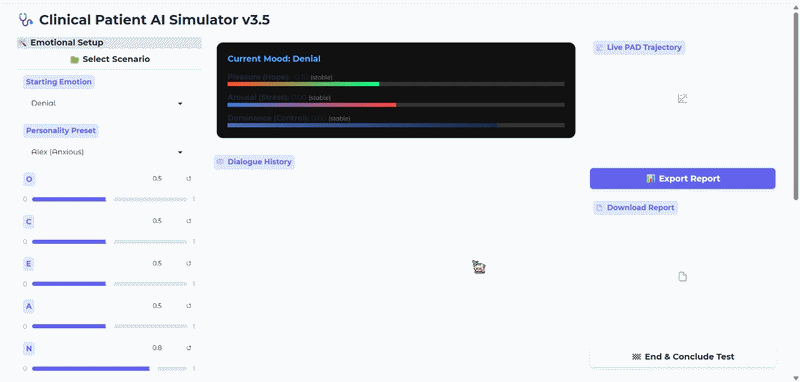
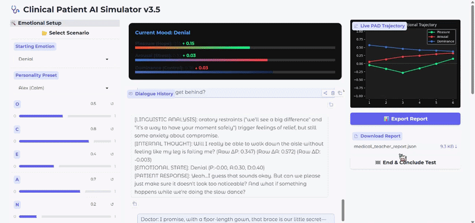

# Clinical Patient AI

**Clinical Patient AI** is a medical education simulator that uses **Additive Affective Steering** to model realistic patient emotional responses. By combining a fine-tuned **DeBERTa** regressor for real-time PAD (Pleasure, Arousal, Dominance) prediction with a steered **Llama 3.2 3B** model, the system simulates complex psychological states—such as trauma, hostility, or anxiety—during clinical consultations.

-----

## 🚀 Key Features

* **Affective Steering Hook:** Implements an additive "nudge" to the transformer's hidden states, aligning the model's output with a specific PAD vector without altering sequence length.
* **Selectable layer hooked:** Implements injection layer to changeable for testing with various level of how the emotion inject into the LLM model
* **Dual-Model Architecture:**
    * **DeBERTa-v3 Regressor:** Analyzes doctor input to predict emotional shifts **($\Delta P, \Delta A, \Delta D$)**.
    * **Llama 3.2 3B:** Generates the patient's internal thoughts and dialogue, steered by the affective hook.
* **Affective Engine:** A sophisticated math engine based on **Affective Chronometry**  (Davidson, 1998) and **Cognitive Appraisal** (Lazarus, 1991) that modulates emotions based on the **Big Five (OCEAN)** personality traits.
* **SPIKES Evaluation:** Includes an automated "Clinical Supervisor" that evaluates student adherence to the SPIKES protocol for breaking bad news.
* **Real-time Dashboard:** Interactive Gradio UI featuring live PAD trajectory plotting and emotional trend tracking.

-----

## 🛠️ Update

  * Fix scenario 1
  * Fix mismatch dimension value in main.py
  * Add user name and password to try the auth function of gradio lib.
  * User name: admin | Password: password123

## 🛠️ Installation & Setup

### Prerequisites

  * Python 3.10+
  * CUDA 12.x (Recommended for inference)
  * PyTorch 2.0+

**1. Clone the Repository**

```bash
git clone https://github.com/pqSatoupq/patient_AI-SIIT_KAIT.git
cd patient_AI-SIIT_KAIT
```

**2. Install Dependencies**

```bash
pip install -r requirements.txt
```

**3. Download Pre-trained Models from Hugging Face** 🤗

```bash
python -c "
from huggingface_hub import hf_hub_download
import os

os.makedirs('model', exist_ok=True)

# Download encoder
hf_hub_download(repo_id='pqSatoupq/PTAI', filename='deberta-pad(centered_dataset_v1)', local_dir='model')

# Download steering matrices
hf_hub_download(repo_id='pqSatoupq/PTAI', filename='llama_projector_aligned2.pt', local_dir='model')

print('✓ Models downloaded successfully!')
"
```

For the **Llama 3.2-3B** is the open source LLM for META, but you need to access permission from them to download it.

**4. Model Placement**

Due to file size limits, model weights are not included. Please place your models in the following directory structure:

```plaintext
/models
  ├── /Llama3.2-3B             # Base Llama 3.2 weights
  ├── /deberta-pad             # Fine-tuned DeBERTa regressor
  └── llama_projector_aligned2.pt  # Trained Llama Emotional Projector
```

**5. Scenario Configuration**

Add custom clinical cases to the `/scenarios` folder as `.txt` files using the following tags:

* `[DESCRIPTION]`

* `[SYSTEM PROMPT]`

* `[STARTING EMOTION]`

* `[PRESET]` (e.g., Anxious, Hostile)

-----

## 💻 Usage

**To launch the simulation**, run:

```bash
python main2.py
```

The interface will be available locally at `http://localhost:7861`.

**Choose the scenarios for clinical report simulation**

Click the `📂 Select Clinical Scenario` and click the scenarios you want to start.



Also you can make your own scenarios by making another text(.txt) file by following the example file and put it inside `scenarios` folder.

For sliding `O, C, E, A, N` is stand for *Big Five Traits Factor* value. You can adjust and custom your own patient personality or using preset dropdown for quick setup.

**End & Conclude Test / Clinical Debrief**

Use to end the conversation and send all of the conversation history back to LLM and aks it to act as the commentator to give feedback for the Clinical report testing.



**Remark that:** the score for each section is only making by the LLM itself. There are no clear criteria for the score calculation analysis, this is merely a simple analysis generated by an LLM.

### For forward hook edition(main2.py)

You can select which layer the emotion will inject to LLM by **Target Injection Layer** slide and you can enable **Dual Injection Mode** to inject the emotion into LLM two selected layer at the same time, or **Distributed Mode (Multi-Layer)** for inject small emotion signals for selecting start layer to end selecting layer.

**Show Patient Face** can use to enable or disable the feature to show the avater image stand for expess the patient emotion, can select or add the new avater image by making another folder inside `charecter` folder and paste the image for each emotion **(need to have image for every emotion to working perfectly)**

-----

## 📂 Project Structure

| File | Description |
| :--- | :--- |
| `main2.py` | Main entry point and Gradio UI logic. |
| `main.py` | Legacy version that use the soft-prompt injection instead of Steering Hook. |
| `affect_engine.py` | Logic for updating emotional coordinates and personality modulation. |
| `inference.py` | Model loading and inference setup for Llama and DeBERTa. |
| `models.py` | Definitions for the `DebertaPureRegressor` `and LlamaEmotionalProjector`. |
| `utils.py` | UI helpers, dashboard rendering, and scenario loading. |
| `config.py` | Path configurations and `EMOTION_MAP` constants. |
| `scenarios` | Folder use to store clinical Scenario. |
| `charecter` | Folder use to store avater image. |

## 🧠 The Affective Logic

The simulator uses Personality-Modulated Drift. For every turn:
1. **Perception:** DeBERTa calculates the impact of the doctor's words.
2. **Modulation:** The update_coord function applies **Viscosity** (emotional resistance) and **Rumination** (emotional persistence) based on the patient's Neuroticism ($N$).
3. **Stabilization:** **Internal Drift** pulls the patient back toward their personality baseline, modeled after the Big Five traits.